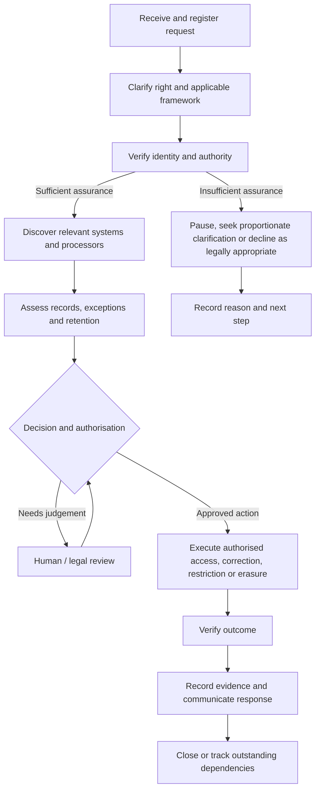

# Privacy by Design: Understanding DSRs and PrivacyOps

> **Start here:** This guide explains the language, legal logic and operational lifecycle behind Data Subject Requests (DSRs), then connects those ideas to the PrivacyOps DSR & Consent Automation Engine in this repository.

**Audience:** privacy and data-protection practitioners, lawyers, engineers, product teams, students and reviewers exploring the project.

**Scope note:** This is educational material, not legal advice or a determination that a particular law applies. The application is a portfolio prototype using synthetic/demo data, local case metadata and mock enterprise connectors. It is not a production compliance platform or a registered Consent Manager.

## 1. The problem: a privacy right must become an operational outcome

A privacy law or policy may give an individual a right concerning personal data. Exercising that right inside an organisation is rarely just a button press. Relevant information may sit in several systems, be handled by processors, be subject to identity checks, or need to be retained for a valid legal or regulatory reason.

A workable process must answer questions such as:

- Who is making the request, and are they authorised to make it?
- Which privacy framework applies, and what right is being exercised?
- Which systems and processors may hold relevant data?
- Are there exceptions, retention obligations, third-party interests or legal holds that require review?
- What action is authorised, and how will its result be verified?
- What can the organisation evidence about the decision, execution and response?

**PrivacyOps is the bridge between a privacy obligation and the people, processes and technical controls needed to carry it out.** The aim is not to automate legal judgement away. It is to make decisions consistent, reviewable, operational and evidenced.

## 2. The terminology

| Term | Meaning |
|---|---|
| **Personal data / personal information** | Information relating to an identified or identifiable person, as defined by the applicable framework. The precise statutory definition varies. |
| **Data subject** | The individual to whom personal data relates. Some laws use different terminology, such as “individual” or “principal.” |
| **DSR — Data Subject Request / Data Subject Rights** | An umbrella term often used operationally for a request to exercise a data-protection right. Usage varies between organisations. |
| **DSAR — Data Subject Access Request** | Usually a request to access personal data. Some teams use DSAR more broadly as a label for rights requests; always define the term in context. |
| **Access** | Providing an appropriate response about personal data being processed and, where required, a copy of the relevant data. |
| **Rectification / correction** | Correcting inaccurate or incomplete personal data where the applicable law provides that right. |
| **Erasure / deletion** | Removing personal data when erasure is available and legally appropriate. It is not an unconditional right in every situation. |
| **Restriction** | Limiting specified processing in circumstances recognised by the applicable framework. Restriction is not necessarily the same as deletion. |
| **Anonymisation** | Transforming data so that individuals are no longer identifiable under the relevant standard. Merely masking identifiers or using pseudonyms is not automatically anonymisation. |
| **Data fiduciary / controller** | A role that determines purposes and means, or otherwise carries the responsibilities assigned by the relevant law. These concepts are related but not interchangeable in every legal detail. |
| **Data processor** | An entity processing personal data on behalf of another organisation under the applicable framework and arrangement. |
| **Identity assurance** | Checks proportionate to the risk of disclosing or changing personal data, designed to establish that the requester is the person they claim to be or is properly authorised. |
| **System discovery** | Finding the systems, records and responsible parties likely to hold data relevant to a request. |
| **Legal hold / retention review** | A documented assessment of whether specific information must be preserved or cannot yet be erased. A hold should have a valid basis, appropriate scope and review; it should not be used as a blanket excuse to reject every request. |
| **Human review** | Review by an authorised person when a case is uncertain, sensitive, exceptional or requires a legal or policy decision. |
| **Audit trail / evidence package** | Records of relevant events, decisions, actions, verification results and timestamps. Evidence of a technical event does not by itself prove the underlying facts or legal compliance. |
| **RBAC — Role-Based Access Control** | Restricting actions according to a user's assigned role and permissions. |
| **DPIA — Data Protection Impact Assessment** | A structured assessment required in specified circumstances under some frameworks, including GDPR where processing is likely to result in high risk to individuals' rights and freedoms. It is not the same as every vendor or privacy-risk questionnaire. |
| **Privacy by Design (PbD)** | Integrating privacy considerations and safeguards into the design, development and operation of systems and processes, rather than adding them only after launch. |
| **PrivacyOps** | The operational discipline of coordinating privacy processes, governance, technology, people and evidence across an organisation. It is a practical term, not a single universal statutory definition. |

## 3. DSR is a lifecycle, not a single API call

The following is a conceptual workflow. Actual steps, deadlines, rights, exceptions and response duties depend on the applicable law, the request facts and the organisation's role.

### What each stage is trying to achieve

1. **Intake and classification:** capture only the information needed to handle the request, assign a reference, identify the right being exercised and establish which legal pathway may apply.
2. **Identity and authority:** prevent unauthorised disclosure or alteration. Checks should be proportionate; collecting excessive identity documents can create its own privacy risk.
3. **Discovery:** search relevant sources in a controlled and repeatable way. In a real deployment this may require data inventories, search keys, system owners and processor coordination.
4. **Decision and exceptions:** evaluate applicable legal requirements, retention duties, exemptions, third-party rights and any genuine preservation obligation. Escalate uncertainty instead of silently treating a rule-engine output as a legal conclusion.
5. **Authorised execution:** perform only the action approved for the relevant records and systems. A request may have different outcomes for different records.
6. **Verification:** check that the intended action occurred. For example, an erasure workflow should test for the targeted record's absence in the relevant system; an access workflow should validate that the response belongs to the correct subject and is appropriately redacted.
7. **Response and evidence:** communicate the outcome within applicable requirements, record reasons and outstanding dependencies, and retain evidence under an appropriate retention policy.
8. **Closure and follow-up:** close only when the defined completion conditions are met, or explicitly mark unresolved processor acknowledgements and other dependencies.

## 4. What Privacy by Design means in practice

Privacy by Design is not just a privacy notice, a consent checkbox or a security feature. It means the product and its operating procedures are deliberately designed to reduce privacy risk throughout the data lifecycle.

| Design principle | Practical implementation question | Example control |
|---|---|---|
| **Proactive, not reactive** | Can the process identify predictable failure modes before an incident? | Test identity failure, duplicate requests and processor timeouts. |
| **Privacy as the default** | What happens if a user takes no extra action? | Deny unauthorised access by default; collect only necessary request fields. |
| **Privacy embedded in design** | Where does the legal/policy rule enter the workflow? | A documented decision layer before a sensitive operation. |
| **Positive-sum thinking** | Can the organisation meet its operational need without unnecessary exposure? | Use targeted discovery and record-level decisions rather than exporting every record. |
| **End-to-end security** | How are data and evidence protected throughout processing? | Authentication, least privilege, secure transfer, controlled retention and monitoring. |
| **Visibility and transparency** | Can an authorised reviewer understand what happened? | Explainable decision records, status tracking and an audit trail. |
| **Respect for the individual** | Is the process accessible, proportionate and responsive? | Clear request routes, appropriate identity checks and meaningful status updates. |

These principles are often associated with the Privacy by Design framework developed by Ann Cavoukian. They are a design framework, not a substitute for checking the actual statutory obligations that apply to a particular processing activity.

### Translate principle into control into evidence

A useful PrivacyOps design pattern is:

**Privacy requirement → risk or failure mode → technical / procedural control → verification → evidence → accountable review**

For example:

- **Requirement or objective:** do not disclose a person's data to an unauthorised requester.
- **Risk:** a person impersonates the data subject.
- **Control:** proportionate identity assurance before fulfilment.
- **Verification:** test that a low-assurance request cannot reach the access or erasure action.
- **Evidence:** record the assurance outcome, decision and relevant event without unnecessarily copying identity documents into the audit log.
- **Review:** define how an unsuccessful check can be resolved and when the request can lawfully be declined or paused.

The same reasoning applies to deletion, consent withdrawal, processor instructions and retention decisions.

## 5. How this connects to the PrivacyOps DSR & Consent Automation Engine

This repository is a **techno-legal portfolio prototype** demonstrating how selected privacy operations can be represented in software. It uses synthetic/demo data, local case metadata and mock connectors; it does not discover or modify records in live enterprise systems.

| Privacy problem | Prototype concept | What a reviewer should look for |
|---|---|---|
| Insufficient identity assurance | Identity-assurance gate | Does an insufficient-assurance case stop before fulfilment and produce a recorded outcome? |
| Different rules across frameworks | Config-driven jurisdiction/rules layer | Are rules explicit and reviewable rather than hidden throughout application code? |
| Data scattered across systems | Mock multi-system connectors | Is discovery separated from the decision and execution layers? |
| Different records need different outcomes | Record-level retention decisions | Can the workflow distinguish erasure, anonymisation, restriction and escalation? |
| A sensitive action needs authorisation | RBAC and human approval workflow | Are unauthorised approvals denied and decisions recorded? |
| A processor may not acknowledge an instruction | Processor orchestration | Are acknowledgement, retry and pending states visible rather than assumed complete? |
| An action may fail silently | Post-execution verification | Does the system check the result rather than merely record that an action was attempted? |
| A decision must be reviewable later | Hash-chained audit ledger | Can event-chain integrity be checked, and are its evidentiary limits explained? |
| Consent withdrawal affects downstream processing | Consent lifecycle and propagation | Are purposes and data categories matched, and are affected systems verified? |
| Duplicate requests may be submitted | Duplicate-request detection | Is the duplicate rule explicit, and can legitimate distinct requests still be handled? |

For the current implementation, use the source code, tests and README to confirm exactly which behaviour is implemented. A test passing demonstrates the tested behaviour under its test conditions; it does not establish production readiness, complete legal compliance, or the truth of data in an external system.

## 6. DSR handling and consent withdrawal are related but different

A DSR and a consent withdrawal may touch the same systems, but they should not be treated as the same event.

- A **rights request** asks an organisation to act on a right available under an applicable legal framework.
- A **consent withdrawal** changes the status of consent for the processing to which that consent relates. It does not automatically determine the legal basis for every other processing activity.
- A **retention obligation or legal hold** may affect whether certain records can be erased, but it must be assessed against the applicable law and the facts.
- A **processor instruction** may be necessary to carry out a decision, but sending an instruction is not proof that the processor completed it.

The prototype's consent workflow therefore models purpose/data-category matching, downstream propagation and post-propagation verification. It deliberately distinguishes consent-dependent processing from systems that rely on another recorded processing basis. In a real system, that classification must be accurate, current and supported by governance and evidence.

## 7. Important failure paths to design for

A credible workflow does not demonstrate only the happy path. It makes failure visible and provides a controlled next step.

- **Identity cannot be established:** do not disclose or alter the data. Record the outcome and provide an appropriate clarification path where available.
- **The data search is incomplete:** mark the case as incomplete or escalated; do not represent partial discovery as a complete response.
- **A retention issue is identified:** preserve only what is justified, record the rationale and scope, and route the issue for the required review.
- **A processor does not acknowledge an instruction:** retain a pending state, retry under a defined policy and escalate when required. Do not mark the whole workflow complete merely because the request was sent.
- **Verification fails:** treat the operation as unresolved, investigate and preserve the relevant evidence.
- **A duplicate is detected:** apply a transparent rule and retain enough information to explain the decision, while avoiding unnecessary data retention.
- **A rule is uncertain or outdated:** stop automatic decision-making at the appropriate boundary and require an authorised review.
- **The audit record is incomplete or inconsistent:** flag the integrity issue. A hash chain can help reveal tampering, but it does not prove that every event was recorded or that the original event was true.

## 8. A practical checklist for a Privacy by Design review

Use this checklist when assessing a DSR or consent workflow. It is a starting point, not a certification.

- [ ] Define the processing purpose, data categories, systems and accountable roles.
- [ ] Identify the applicable framework and validate its scope, current commencement, rules and deadlines.
- [ ] Minimise intake fields and protect request records.
- [ ] Design proportionate identity and authority checks.
- [ ] Document data-discovery coverage and known blind spots.
- [ ] Define decision criteria, exceptions, retention handling and escalation boundaries.
- [ ] Require appropriate authorisation for high-impact operations.
- [ ] Verify actual outcomes rather than relying only on successful API responses.
- [ ] Track processor and subprocessor dependencies, acknowledgements and failures.
- [ ] Keep audit evidence access-controlled, integrity-checked and subject to a defined retention policy.
- [ ] Test failure paths, duplicate requests, partial execution and recovery.
- [ ] Provide meaningful responses and accessible escalation routes.
- [ ] Review the design periodically as systems, vendors, laws and processing purposes change.

## 9. Legal reference points for further reading

Use official texts and guidance to validate the legal analysis. These references are starting points, not a statement that every provision applies to every request.

- **India — Digital Personal Data Protection Act, 2023:** [India Code](https://www.indiacode.nic.in/indiacode/handle/123456789/22037?view_type=browse).
- **India — Digital Personal Data Protection Rules, 2025:** [Ministry of Electronics and Information Technology](https://www.meity.gov.in/documents/act-and-policies/digital-personal-data-protection-rules-2025-gDOxUjMtQWa?pageTitle=Digital-Personal-Data-Protection-Rules-2025). Check commencement notifications and applicable provisions before drawing conclusions about current obligations.
- **European Union — General Data Protection Regulation (GDPR):** [EUR-Lex, Regulation (EU) 2016/679](https://eur-lex.europa.eu/eli/reg/2016/679/oj/eng/). Relevant starting points include Articles 12–22 on data-subject rights, Article 25 on data protection by design and by default, Article 28 on processors, Article 32 on security and Article 35 on DPIAs.
- **Privacy by Design background:** [Ann Cavoukian, Privacy by Design](https://www.ipc.on.ca/en/privacy-organizations/privacy-by-design).

**Do not treat GDPR and India's DPDP framework as interchangeable.** Definitions, rights, exceptions, roles, deadlines and implementation details differ. The applicable analysis must be made separately for each framework and the facts of the processing.

## 10. The central idea

A privacy obligation becomes operational only when the organisation can connect a justified decision to an appropriate action and then establish what happened.

> **Legal / privacy decision → Technical control → Verification → Evidence → Accountable review**

That is the core idea behind this PrivacyOps lab: not to replace lawyers, privacy professionals or regulators, but to demonstrate how privacy decisions can be translated into controlled, testable and reviewable workflows.

---

**Project:** [PrivacyOps DSR & Consent Automation Engine](https://github.com/advabhishekkishan-tech/DPDP-GDPR-DSR-Automation-Engine)  
**Author:** Abhishek Kishan — Advocate | PrivacyOps & Data Protection

*Educational documentation for a portfolio prototype. Not legal advice, a compliance certification, or a claim of production readiness.*
